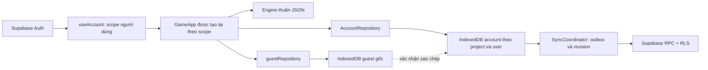

# Cloud v0.3 — ranh giới dữ liệu và vận hành

Migration003 đã duyệt/applied đúng project: mkv_valid_save nhận thêm schema4/engine-content3, giữ tuple cũ và toàn bộ RLS/grants. Inventory trong JSON snapshot, dùng cùng CAS/receipt/outbox/recovery/immutable archive. QA bổ sung mua/mặc và tải mobile, không credentials trong report.

App beta 0.3.0 giữ engine/content 2.0.0, schema save 3. Luật v1 vẫn đóng băng. Không đổi RNG, số tiền hay action log để đưa một cuộc đời lên cloud.

## Guest và account

`GameRepository` là giao diện chung: đọc/ghi autosave, ba slot, archive, lịch sử và import. Guest dùng `mot-kiep-viet`/`saves` và `mot-kiep-viet-history`/`lives` như v0.2. Account dùng `mot-kiep-viet-accounts` riêng, với prefix origin project + UUID người dùng. Login không upload guest, logout không xóa guest.

`useAccount` kiểm tra phiên Auth và allowlist phía server. `GameApp` có key theo user UUID, vì vậy state, dialog, journal và session cũ bị gỡ trước hiển thị tài khoản tiếp theo. Mỗi repository nhận một data client với nguồn access token riêng; worker cũ không lấy JWT mới của tài khoản B. Worker đóng khi logout/switch; request đã gửi có thể ghi nhận receipt vào đúng cache cũ nhưng không cập nhật UI mới.

Khi mất mạng, một phiên đã được xác nhận trên thiết bị có thể dùng cache của chính người đó. Marker local chỉ giúp mở cache offline; không cấp quyền SQL. Bất kỳ request nào vẫn cần JWT hợp lệ và RLS/allowlist. Dữ liệu trên máy không được thiết kế chống người có DevTools hoặc kiểm soát cùng hồ sơ trình duyệt.

## Save và chống xung đột

Save đầu vào/đầu ra cloud đều qua `parseSave` và replay tương ứng. Snapshot cloud có identity UUID; UUID ở ngoài RNG. Bản khôi phục cùng identity nhưng phân nhánh sẽ nhận UUID mới khi được tách để hai kết thúc có thể tồn tại độc lập.

Account ghi local + outbox trước, rồi đồng bộ. Một slot có thể coalesce bản chưa gửi; bản đã gửi giữ nguyên operation ID, payload và expected revision khi retry. Receipt server ràng buộc toàn bộ yêu cầu; gửi lại không tăng revision lần nữa. RPC khóa theo user/slot và kiểm tra revision trong transaction. Không dùng giờ máy khách chọn người thắng. HTTP `PT409` biểu diễn xung đột dự kiến; mã SQL `40001` cũ từng dẫn tới timeout 504 trên gateway thật, đã sửa bằng migration được phê duyệt riêng.

Client giữ nhánh cạnh tranh, giải thích hai bản và chờ lựa chọn. Nhánh thua được lưu cục bộ thành recovery có thể xuất hoặc chơi tiếp. Muốn giữ recovery trên cloud, người dùng mở nhánh đó rồi lưu vào một ô còn trống. Không tự ghép action log. Khi tải/đổi nhánh, parser/replay vẫn được kiểm tra.

Outbox giới hạn 64 thao tác, retry tự động tối đa 8 lần với backoff tối đa 5 phút. Reconnect bỏ thời gian chờ còn lại nhưng không tự cấp lại retry budget đã hết; nút đồng bộ là retry có chủ đích. Queue đầy vẫn giữ snapshot local mới nhất ở trạng thái lỗi, không báo đã đồng bộ. Bản local trùng run đã lưu không phát sinh ghi cloud vô ích.

## Lịch sử

`CloudLifeRepository` tải 20 bản mỗi trang, cursor gồm server created_at + UUID. Record có hồi ký gốc và snapshot/version đầy đủ; tải về qua `validateLifeRecord`. Account cache có outbox archive riêng và retry hữu hạn. Kết thúc đời không phụ thuộc ghi đè autosave/slot. Server dedup user + life UUID + digest run/memoir; không cho UPDATE/DELETE trong gameplay. Tệp import tối đa 50 bản/20 MiB; xuất các bản đã tải tối đa 50 một tệp hoặc xuất từng đời. Lưu local và retry không xóa bản trên server.

Chuyển guest có preview save/history và tài khoản đích, nút xuất backup, checkbox rồi xác nhận. Slot trống nhận guest; slot đã có giữ nguyên, guest cạnh tranh vào recovery. Lặp lại cùng nội dung không nhân bản recovery. Guest vẫn nguyên vẹn dù mạng lỗi hoặc upload một phần; retry theo identity/receipt để hoàn tất phần còn lại.

## Offline shell

`public/sw.js` chỉ cache HTML/JS/CSS/font/image cùng origin và cùng subpath. Không cache Supabase/API/Auth responses. HTML có network-first và fallback, tài nguyên tên hash có cache-first. Cache chỉ chứa app shell công khai; IndexedDB giữ dữ liệu riêng. Cần đã mở và cài shell một lần online trước reload offline. Local preview có `Vary: Origin`; cache matching chỉ bỏ Vary cho các tài nguyên tĩnh công khai đã kiểm tra cùng origin. Không áp dụng chính sách đó cho API.

## Quyền server

`mkv_private.invited_users` chỉ admin quản lý. Bốn bảng public bật RLS, anon không có quyền; read gắn auth.uid và allowlist. Profiles chỉ được ghi display_name của mình; UPDATE có USING/WITH CHECK và không cấp ghi user_id. Save/history/receipt không cấp DML trực tiếp. Ba hàm SECURITY DEFINER có search_path rỗng, không SQL động, không tham số giả user_id; lấy auth.uid và kiểm tra allowlist trước truy cập. Cần quyền definer để không cho client bỏ qua CAS bằng UPDATE bảng trực tiếp. Advisor Supabase cảnh báo ba hàm authenticated gọi được; đây là đường API có chủ đích, đã đọc mã và thử deny bằng JWT A/B/anon, không phải cảnh báo đã biến mất.

Server kiểm tra envelope/version/identity/action count/size, không thực thi engine TS trong PostgreSQL. Một người dùng có quyền vẫn có thể gửi dữ liệu game hỏng của chính mình; client không tin dữ liệu cloud và phải replay trước sử dụng. Đây không phải hệ thống chống gian lận hay chứng nhận bảo mật độc lập.

## Kiểm chứng và vận hành

`npm.cmd run verify`, `test:e2e` trên production subpath, `test:production` và secret scan là gates thông thường. `npm.cmd run test:cloud:live -- --browser` chạy riêng trên Windows với CLI đã login và project đã được duyệt. Runner chỉ nhận public config qua env, lấy quyền admin qua CLI vào bộ nhớ để tạo/vô hiệu hóa tài khoản QA. Assertions dữ liệu dùng public key + JWT authenticated thật; service-role chỉ chuẩn bị/vô hiệu hóa fixture, không chứng minh RLS. Tài khoản, password, JWT QA không được ghi vào repo/log; report chỉ có tên check và kết quả. Runner không gửi email. SMTP, invitation và email recovery ngoài phạm vi theo quyết định mới; người chủ tự nhập tài khoản đã có trên live.

Không chạy migration hay live QA có quyền admin tự động trên GitHub Actions. Tham khảo [SUPABASE_SETUP](SUPABASE_SETUP.md), [V03_PROGRESS](V03_PROGRESS.md), [báo cáo v0.3](V03_REPORT.md).

## Continuous story và hai tab

Application storyAction chỉ ghi choose/advance sẵn có, không sửa engine/content/schema. Decision token gồm run ID/action count/month/event ID; ref đồng bộ chặn callback cũ trước render. Native double-click/repeat bị bỏ qua; focus trở lại heading, scroll vào story thay vì đầu trang. Outcome và các entry hệ quả giữ nguyên trong journal/feedback. Không tự chọn và không tự manage tiền/nghề.

Ghi account trong một repository được tuần tự hóa. Cache.writeLocal có expected branch so với save trong cùng transaction IndexedDB; hai tab cùng đọc một base không được coalesce đè nhau. Tab stale giữ snapshot riêng vào recovery với UUID mới và báo lỗi. Server CAS vẫn là ranh giới giữa các thiết bị.
